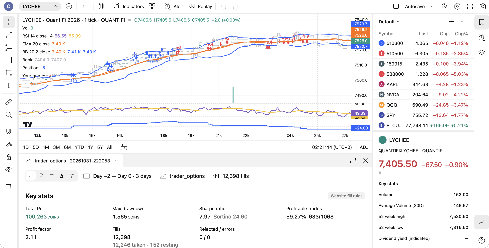
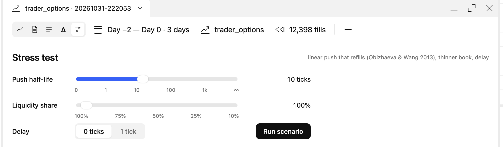

# TradingView-style open quant dashboard

A self-hosted, TradingView-style dashboard for charting and backtesting. You can run Pine strategies in it, or open runs from your own backtest engine: the Strategy report then shows the fills on the chart, the strategy's own indicators, drawdown, Sharpe, Greeks and stress tests. It was built during the UTEFA QuantiFi 2026 algorithmic trading competition, so that competition's replay engine is included as the worked example of a custom engine.



| Folder | What it is |
|---|---|
| [`dashboard/`](dashboard) | The app: FastAPI server, TypeScript web UI on lightweight-charts, and a Node sidecar for market data. It has indicators, drawings, alerts, a Pine interpreter with a TradingView-style broker emulator and an Optuna optimiser, and the Strategy report. |
| [`engine/`](engine) | The QuantiFi replay engine. It replays order books tick by tick under the competition website's fill rules, plus slippage stress scenarios (Obizhaeva–Wang linear transient impact, a thinner book, a delay). |

## Quick start

```bash
# engine: put the competition CSVs in engine/Data/ (not included), then
cd engine && python3 tools/backtest.py submission/example_trader.py

# dashboard
pip install -r dashboard/server/requirements.txt
(cd dashboard/sidecar && npm install) && (cd dashboard/web && npm install)
cd dashboard && ./dev.sh          # open http://127.0.0.1:5173
```

To see an engine run in the dashboard: Strategy report → runs → *QuantiFi 2026*, or **New QuantiFi run** to replay a strategy file from `engine/submission/`. The run's fills, quotes and indicators appear on a tick-level chart. The dock shows Key stats, Products, Greeks, and a **Stress** view with sliders.



## Using your own engine

The dashboard reads an engine's runs from files, so an engine only needs to write the same run folder (`meta.json`, `fills.csv`, `equity.csv`, optional `greeks.csv` and `indicators.csv`; see [`engine/README.md`](engine/README.md)). Point `TVRE_QUANTIFI_ROOT` at a folder with that engine's `tools/backtest.py`, `Data/` and `runs/`. The server module that turns runs into reports is `dashboard/server/tvre/quantifi.py`. There is also a bridge for a qlib portfolio engine (`dashboard/server/tvre/backtest.py`); that engine is not included.

## Data

No market or competition data ships with this repository. Live charts come from TradingView through the unofficial [`@mathieuc/tradingview`](https://github.com/Mathieu2301/TradingView-API) client; use it within TradingView's terms.

## License and credits

MIT (see [LICENSE](LICENSE)). Charts are rendered with TradingView's open-source [lightweight-charts](https://github.com/tradingview/lightweight-charts) (Apache-2.0; its attribution stays on the chart). TradingView is a trademark of TradingView, Inc.; this project is not affiliated with or endorsed by TradingView.
